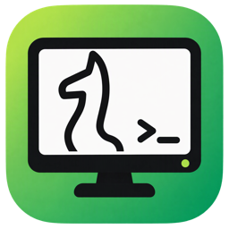
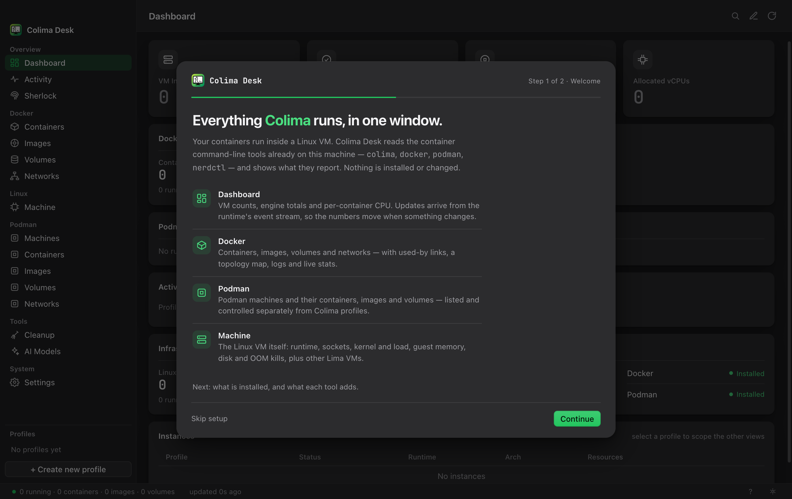
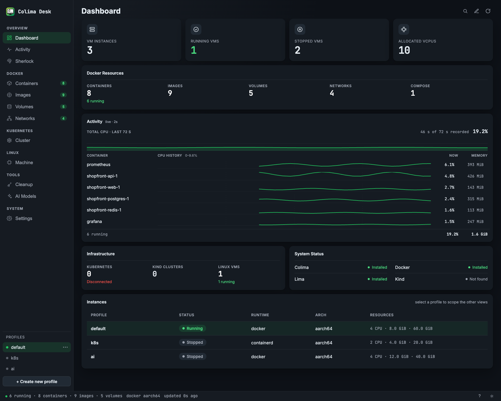
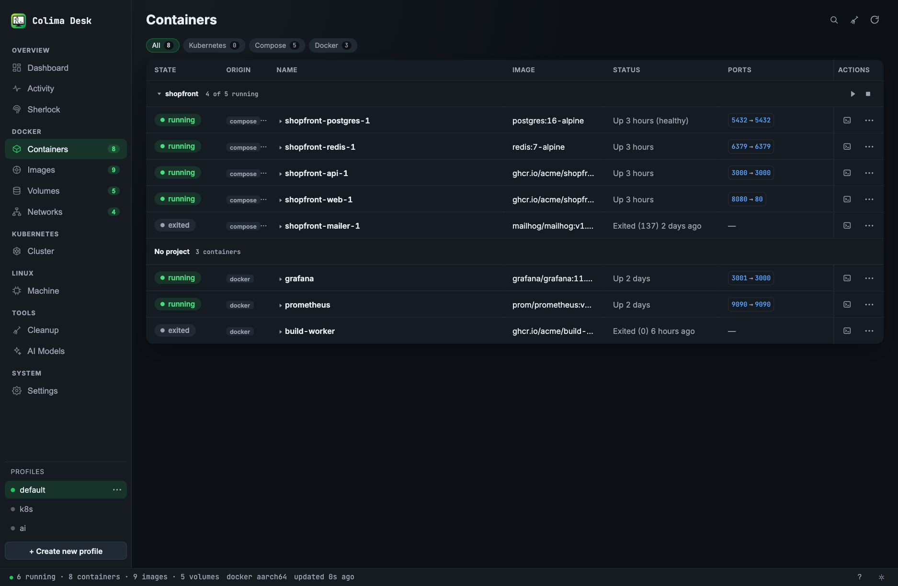
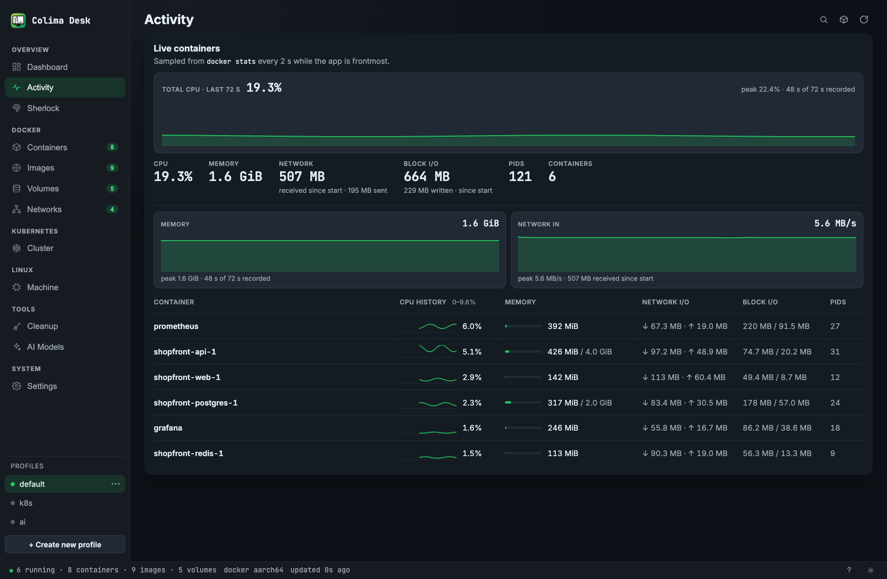
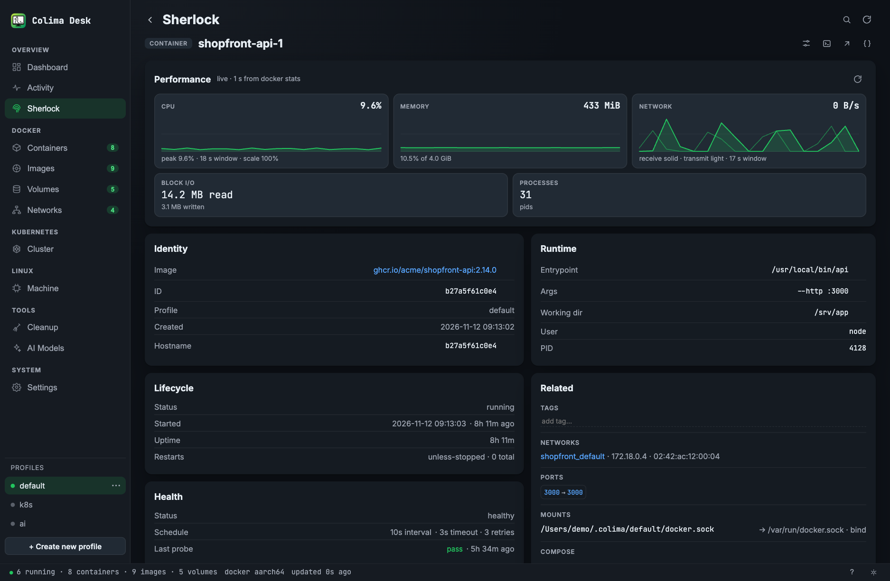
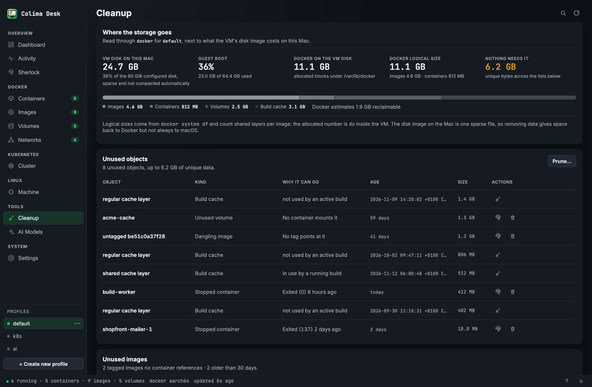
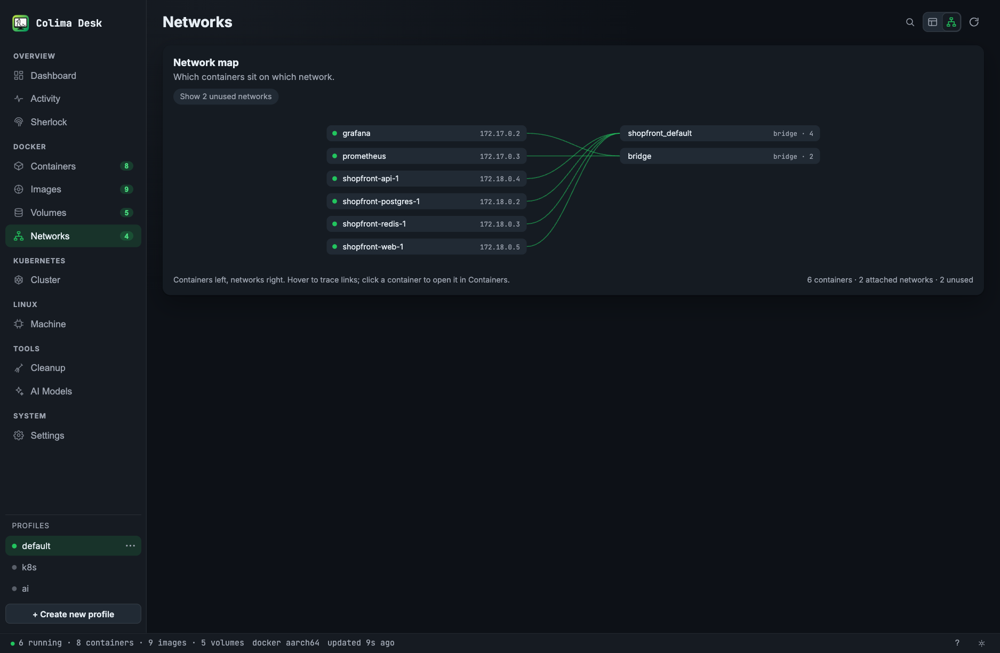
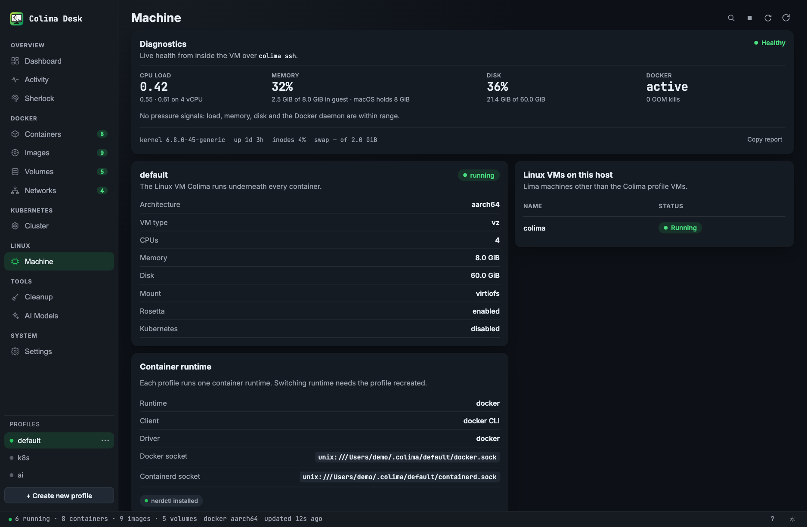

# Runtime Desk

<p align="center">
  
</p>

<p align="center">
  <a href="LICENSE"></a>
  
  <a href="https://buymeacoffee.com/dm0xa"></a>
</p>

**One window over every container runtime on your Mac: Colima profiles, Podman machines, Docker and containerd, and the Linux VMs behind them.** No extra daemon, no database, no second source of truth: Runtime Desk runs the same `colima`, `docker`, `podman`, `nerdctl` and `kubectl` commands you use and shows what they answered.

For macOS developers who want one console over [Colima](https://github.com/abiosoft/colima), a Podman machine or plain Docker, not Docker Desktop.

## Why it's different

- **Runtime-aware.** Docker-runtime profiles read through the Docker CLI, containerd through Colima's `nerdctl`; one profile drives every view.
- **Live, not polled.** A `docker events` stream stales views 250 ms after a change, with a 60-second reconciliation pass; containerd profiles keep a 15-second timer, since `nerdctl` cannot replay a dropped connection.
- **Honest errors.** One sentence naming the object and what failed, CLI output under **Show details**; unread counts say so, not zero.

## Highlights

- **Dashboard with custom cards.** A KPI row (VM instances, running VMs, stopped VMs, allocated vCPUs), then resources, storage, Activity, Infrastructure, Instances, Recent containers and System Status; drag to reorder or into **Hidden cards**, cycle Auto, Half, Full, **Reset layout**.
- **Activity monitor.** 72 seconds of per-container CPU history (36 samples, two seconds apart) plus memory, network, block I/O and PIDs; an OOM warning at 90% of a container's limit or the VM's.
- **Docker lists you can act from.** Containers filter All, Compose, Docker, Kubernetes; Images and Volumes All, Unused; Networks All, User-defined; rows expand into facts, act in place and refuse removal while in use.
- **Logs and inspect.** 100, 500, 1 000 or 5 000 lines, search with next/previous and **Match only**, error and warning lines coloured; inspect in its own sheet with the same search and line numbers.
- **Sherlock.** What an object connects to: live stats, the last 60 log lines, env vars and labels with secret values masked until **Show N secrets**, health checks, build history, volume contents.
- **Volume browser.** One level at a time through `colima ssh -- sudo find`, read-only, with sizes, owners and modes; a per-volume treemap from `docker system df -v`.
- **Pull without leaving the app.** Docker images from the Images toolbar, Podman from the Podman Images page.
- **Podman, one machine at a time.** A machine picker per page, **New machine…** (`podman machine init`), **Resize…** (`podman machine set`, CPUs and memory only, restart required); every call carries the machine as `CONTAINER_CONNECTION`.
- **Kubernetes.** The single-node k3s in the VM through `kubectl --context colima` (`colima-<profile>` when named), 10-second timeout: nodes, pods, workloads, services, namespaces. Pods show their waiting reason (`CrashLoopBackOff`, `ImagePullBackOff`) instead of "Running"; a silent API server keeps the last counts with their read time. **Enable Kubernetes** runs `colima kubernetes start -p <profile>`; stop is a two-click arm, reset and delete ask for the context name.
- **Machine telemetry.** Kernel, uptime, load, memory, disk, inodes, swap, daemon state and OOM kills from one `colima ssh` round trip; **Resources…** changes CPUs, memory or disk on restart, and **Recreate…** handles the fields Colima only reads at creation (VM type, runtime, mount type, network mode) with an explicit keep-or-delete choice for container data.
- **Networking, not guesswork.** Shared or bridged VM networking, a reachable IP, DNS resolvers and hosts, the gateway, and `ssh`/`grpc`/`none` port forwarding — `grpc` being the one that carries UDP. Mount type, a mount list, inotify propagation and SSH-agent forwarding are creation controls; DNS, forwarder and gateway can still change on a stopped profile.
- **A menu-bar item.** The selected profile and whether it runs, with **Start**, **Stop**, **Show Runtime Desk** and **Quit** — the same actions and refresh path as the window.
- **Apple Silicon, not guesswork.** Images carry their own architecture: an `amd64` row shows whether Rosetta translates it or qemu emulates it, and a container carries the same chip. The Machine page reads the guest's live Rosetta state, and **New profile** switches to `qemu` when the chosen architecture is not the host's — `vz` and `krunkit` boot only that one.
- **Cleanup.** `docker system df -v` plus one guest scan of `/var/lib/docker` and the eight largest container logs, with age, size and why it qualifies; images unused for 30 days are stale, the prune dialog previews every category.
- **AI models.** Pull, chat with and serve a model through Docker or `ramalama` in a `krunkit` profile, choosing registry, model, runner and port.

## Screenshots



<sub>First launch: nine probed tools, what each adds, which are missing.</sub>



| Containers | Activity |
| --- | --- |
|  |  |

| Sherlock | Cleanup |
| --- | --- |
|  |  |

| Networks | Machine |
| --- | --- |
|  |  |

## Requirements

- Colima, for profiles, their runtimes and the VM.
- The Docker CLI for Docker-runtime profiles; containerd profiles use Colima's `nerdctl`.
- Optional: `kubectl` (Kubernetes), `podman` (Podman), `docker compose` (Compose counts and filter), `ramalama` and `krunkit` (AI models), `limactl` (other Lima VMs). A missing tool hides its section.

Building needs Rust, Node.js 20.19+ or 22.12+ and the Xcode command line tools; the image is built for the building machine.

## Run it

### With Homebrew

```sh
brew install --cask dm0xa/tap/runtime-desk
brew upgrade --cask runtime-desk      # when a newer release is out
brew uninstall --cask runtime-desk    # add --zap to drop preferences too
```

Homebrew asks once to trust the tap (`brew trust --cask dm0xa/tap/runtime-desk`). The cask downloads the newest release from this repository, so it needs no update here. The build is ad-hoc signed rather than notarized: the cask removes the quarantine flag only when the signature really is ad-hoc, which is why Gatekeeper stays quiet on first open.

### From source

```sh
git clone https://github.com/dm0xa/runtime-desk.git
cd runtime-desk
npm install
npm run tauri dev
```

Vite holds port 1422 (`strictPort`), so a second dev server fails.

Release build:

```sh
npm run bundle
```

This runs `tauri build --bundles app`, then `src-tauri/dmg/build.sh` lays out the disk image and verifies the Finder layout. Both land in `src-tauri/target/release/bundle/` (`Runtime Desk_<version>_<arch>.dmg`). Unsigned, so macOS may ask on first open.

## First launch

The setup screen probes every CLI it reads, says which are missing and quotes each install command; nothing is installed for you. Pick a profile at the bottom of the sidebar; if stopped, start it from `⋯`. The Podman group needs a running machine: its lists say so and point to Machines, where **New machine…** creates one.

## Keyboard shortcuts

| Shortcut | Action |
| --- | --- |
| ⌘1 … ⌘9 | First nine visible sections |
| ⌘0 | Last visible section (Settings) |
| ⌘K or ⌘F | Search pages, containers, images, volumes, networks, tags |
| ⌘, | Settings |
| ⌘N | New profile |
| ⌘[ | Go back |
| ⌘R | Refresh data |
| ⌘⌥S | Show or hide the sidebar |
| Right-click a row | The row's action menu |
| Esc | Close the dialog or dashboard edit |
| `?` | Show the shortcut list |

## Development

```sh
npm run build            # tsc && vite build
npm run check:commands   # invoke() names and argument shapes against the Rust signatures
npm run check:commands -- --self-test

cd src-tauri
cargo test
cargo build
```

The layout gate needs a fresh `dist/`:

```sh
python3 scripts/headless_probe.py --gate
```

It serves `dist/` with a stubbed `__TAURI_INTERNALS__`, renders every page in 17 states at 900, 1280 and 1600 px, and exits non-zero on clipped chrome, wrong fonts, page overflow or a console error. Needs Playwright's Chromium (`pip install playwright`); `--list` prints states and pages.

More detail:

- [User guide](docs/USAGE.md)
- [Architecture](docs/ARCHITECTURE.md)
- [Dashboard cards](docs/DASHBOARD.md)
- [Development](docs/DEVELOPMENT.md)
- [OrbStack comparison](docs/ORBSTACK.md)
- [Roadmap](docs/ROADMAP.md)
- [Changelog](CHANGELOG.md)

## License

GNU General Public License v3.0 only (GPL-3.0-only). Copyright (C) 2026 Runtime Desk contributors. Full text in [LICENSE](LICENSE); the source of each released build is this repository. Earlier releases shipped under MIT and stay under those terms.

## Thanks

- [Colima](https://github.com/abiosoft/colima) by abiosoft
- [Tauri](https://tauri.app)
- Palette and logo from [colima.run](https://colima.run)
